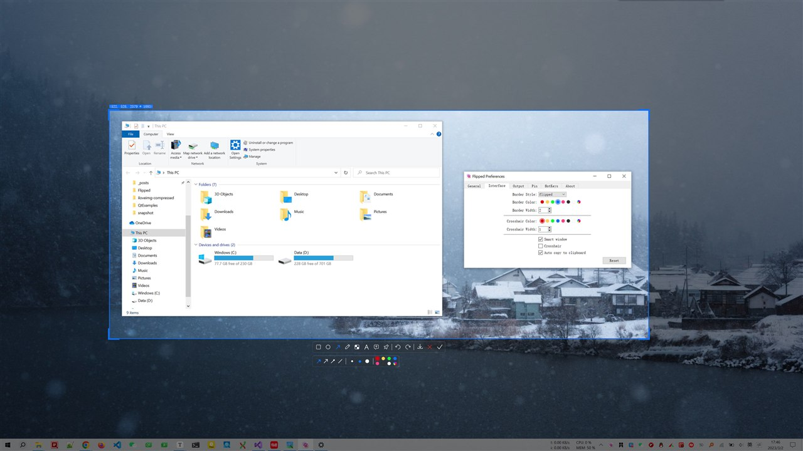

> [!IMPORTANT]
>  **Move to SnipArc**
>
> **November 28, 2026** · Switch to **SnipArc**, our next-generation screenshot and annotation app. We’ll continue to maintain and improve it.
>
> **[Download SnipArc](https://sniparc.mosuzo.com/)** · [Explore more from Mosuzo Studio](https://mosuzo.com/) · [Original project website](https://flipped.xmuli.tech/)

---

 FLIPPED

<a href="README.md">English</a> · <a href="README.zh_CN.md">简体中文</a>

        

> **Archived.** A complete cross-platform screenshot, annotation and pinning tool. Offline by design.
>
> Final release **v1.3.2** · MIT · Qt / C++ · Windows, macOS, Linux

## Overview

FLIPPED is the second and much more ambitious project in the series. It turns a simple capture tool into a small editing surface: window detection, multi-monitor support, annotations and pinning, all without an account or a network connection.

The final release was v1.3.2. The code is MIT licensed and remains a useful reference for Qt desktop tools that care about privacy.

## Highlights

- Smart window detection and multi-monitor capture
- Rectangles, ellipses, arrows, pen, mosaic, text and numbered markers
- Pinning and cross-screen pinboards
- Three capture-border styles with custom accent colors
- Chinese, Traditional Chinese and English UI
- Fully offline, no telemetry or network features
- MIT licensed

## Status

FLIPPED is archived. Windows users can continue with **SnipArc**.

## Links

| | |
| --- | --- |
| **Website** | https://flipped.xmuli.tech/ |
| **Archive entry** | https://screenshot-archive.xmuli.tech/flipped/ |
| **GitHub** | https://github.com/SunnyCapturer/FLIPPED |
| **Historical releases** | https://github.com/SunnyCapturer/FlippedPages/releases |

## The screenshot series

ShotX → FLIPPED → Sunny → SunnyCapturer → SnipArc.  
[Full visual archive](https://screenshot-archive.xmuli.tech/)

## Contact

- **Mosuzo Studio** — https://mosuzo.com/
- **GitHub** — https://github.com/XMuli
- **QQ group** — 418103279 · https://qm.qq.com/q/ff0xkauRdm
