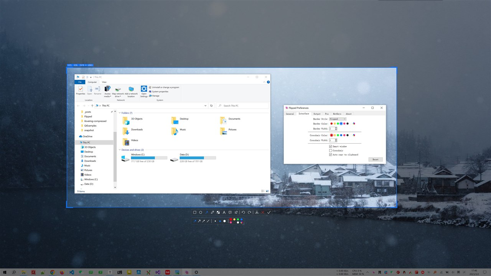

> [!IMPORTANT]
>  **从这里迁移到 SnipArc**
>
> **2026.11.28** · 欢迎迁移到下一代截图与标注工具 **SnipArc**。我们会持续更新和维护 SnipArc，欢迎下载体验。
>
> **[下载 SnipArc](https://sniparc.mosuzo.com/)** · [探索 Mosuzo Studio 的更多作品](https://mosuzo.com/) · [原项目官网](https://flipped.xmuli.tech/)

---

 FLIPPED

<a href="README.zh_CN.md">简体中文</a> · <a href="README.md">English</a>

        

> **已归档。** 一款功能完整的跨平台截图、标注与贴图工具，坚持离线与隐私优先。
>
> 最终版本 **v1.3.2** · MIT · Qt / C++ · Windows、macOS、Linux

## 简介

FLIPPED 是系列的第二件作品，也是野心更大的一次尝试：把简单截图扩展成一块轻量编辑画布，支持窗口识别、多屏截图、标注与贴图，同时不要求账号、不发起联网请求。

最终版本为 v1.3.2，以 MIT 协议开源。对注重隐私的 Qt 桌面工具来说，它仍是一份有价值的参考实现。

## 亮点

- 智能窗口识别与多屏截图
- 矩形、椭圆、箭头、画笔、马赛克、文本与序号标注
- 贴图与跨屏钉图
- 三套截图框样式与自定义主题色
- 简体中文、繁体中文与英文界面
- 完全离线，无遥测、无联网功能
- MIT 开源

## 状态

FLIPPED 已归档。Windows 用户可以继续使用 **SnipArc**。

## 链接

| | |
| --- | --- |
| **官网** | https://flipped.xmuli.tech/ |
| **作品档案条目** | https://screenshot-archive.xmuli.tech/flipped/ |
| **GitHub** | https://github.com/SunnyCapturer/FLIPPED |
| **历史版本** | https://github.com/SunnyCapturer/FlippedPages/releases |

## 截图作品系列

ShotX → FLIPPED → Sunny → SunnyCapturer → SnipArc。  
[完整作品档案](https://screenshot-archive.xmuli.tech/)

## 联系

- **Mosuzo 工作室** — https://mosuzo.com/
- **个人 GitHub** — https://github.com/XMuli
- **QQ 反馈群** — 418103279 · https://qm.qq.com/q/ff0xkauRdm
