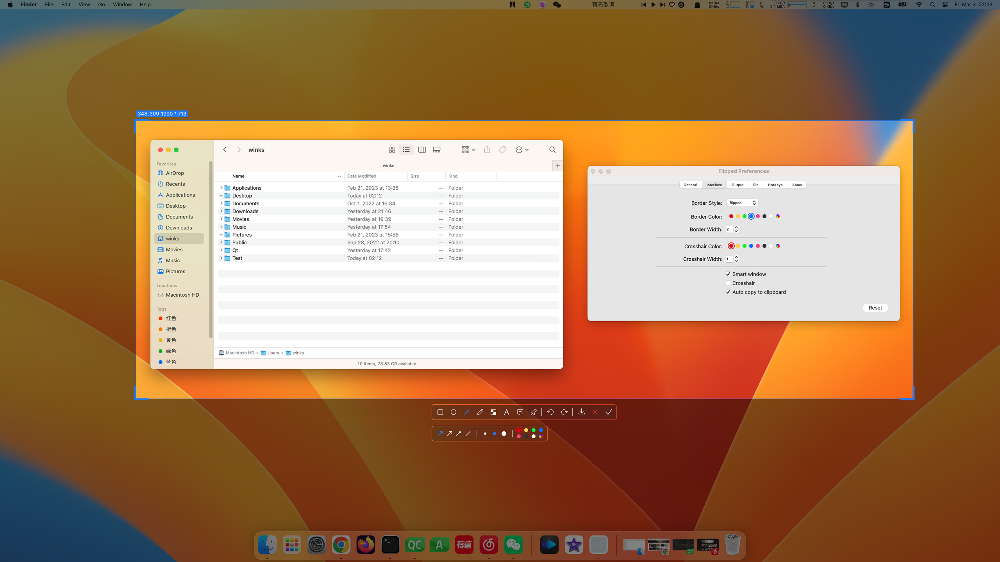
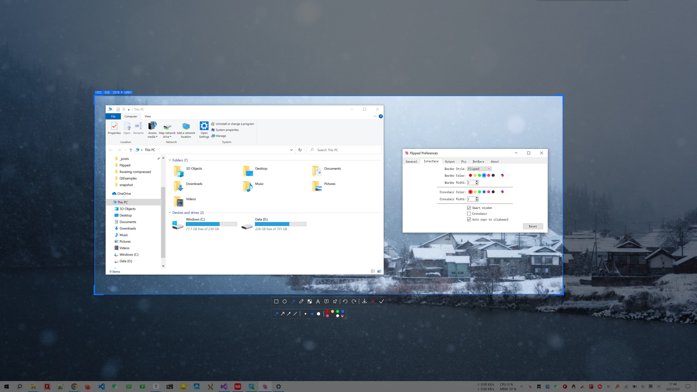
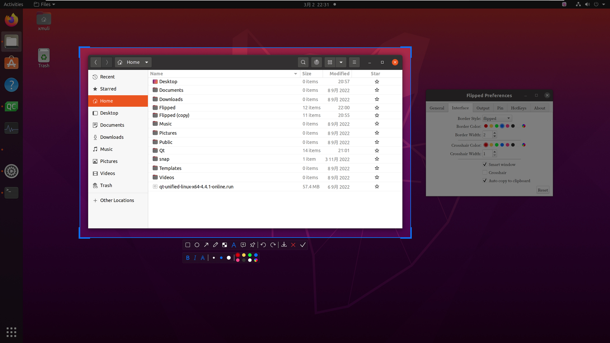

> **FLIPPED archive and migration**
>
> FLIPPED is now a legacy project. Windows users are encouraged to download [SnipArc](https://sniparc.mosuzo.com/download), which remains under active maintenance. [Shotera releases](https://github.com/mosuzo-studio/Shotera/releases) are available as a historical Windows alternative. Regular maintenance for Shotera has ended.

  

      <h1>
      
       
      FLIPPED
    </h1>
     
    <h4>Simple and beautiful screenshot software tool for Windows, MacOS and Linux</h4>
    <h4>简洁且漂亮的截图的软件工具，支持 Windows，MacOS，Linux 平台</h4>
    <h4>簡潔且漂亮的截圖的軟件工具，支持 Windows，MacOS，Linux 平臺</h4>
  

  

    
  
  

> Time: 2024-06-01
>
> FLIPPED 已采用 MIT 宽松协议，开源全部代码，帮助新人降低 C++ / Qt 门槛，可轻松编写一个截图项目

 

## Preview

**MACOS:**

**WINDOWS:**

- **LINUX:**

- **Other:**

More snapshoot effects can be → [here](https://github.com/XMuli/FILPPED/tree/master/snapshot) preview

## Features

**Celebrate with the release of the official version v1.3.0!** 🎉🎉🎉🎊🎊🎊

- Multi-screen screenshot, time-lapse screenshot, custom screenshot
- Pinning the picture
- Intelligent window recognition（Windows & Linux）
- Draw Rectangle, Ellipse, Arrow, Custom Path, Mosaic, Text, Serial Number
- Undo, Redo (multi-level), Save, Cancel, Copy
- Plugin Framework
- Update ... 

## Voide

- [P1] [FLIPPED-MACOS operation demonstration](https://www.bilibili.com/video/BV1rX4y1D7EZ?p=1)
- [P2] [FLIPPED-WINDOWS operation demonstration](https://www.bilibili.com/video/BV1rX4y1D7EZ?p=2)
- [P3] [FLIPPED-LINUX (ubuntu 20.04) operation demonstration](https://www.bilibili.com/video/BV1rX4y1D7EZ?p=3)

 

## Keyboard shortcuts

| Keys                                                         | Description                     | Mode   |
| ------------------------------------------------------------ | ------------------------------- | ------ |
| <kbd>←</kbd>, <kbd>↓</kbd>, <kbd>↑</kbd>, <kbd>→</kbd> ( <kbd>A</kbd>, <kbd>S</kbd>, <kbd>W</kbd>, <kbd>D</kbd> ) | Move selection 1px              | Local  |
| <kbd>Ctrl</kbd> + <kbd>←</kbd>, <kbd>↓</kbd>, <kbd>↑</kbd>, <kbd>→</kbd> | Extended selection 1 px         | Local  |
| <kbd>Alt</kbd> + <kbd>←</kbd>, <kbd>↓</kbd>, <kbd>↑</kbd>, <kbd>→</kbd> | Shrink selection 1 px           | Local  |
| <kbd>Shift</kbd> + <kbd>←</kbd>, <kbd>↓</kbd>, <kbd>↑</kbd>, <kbd>→</kbd> | Move selection 10 px            | Local  |
| <kbd>Shift</kbd> + <kbd>Ctrl</kbd> + <kbd>←</kbd>, <kbd>↓</kbd>, <kbd>↑</kbd>, <kbd>→</kbd> | Extended selection 10 px        | Local  |
| <kbd>Shift</kbd> + <kbd>Alt</kbd> + <kbd>←</kbd>, <kbd>↓</kbd>, <kbd>↑</kbd>, <kbd>→</kbd> | Shrink selection 10 px          | Local  |
| <kbd>Shift</kbd> + <kbd>F4</kbd>                             | Quick Save Image                | Local  |
| <kbd>Esc</kbd>                                               | Quit                            | Local  |
|                                                              |                                 |        |
| <kbd>F6</kbd>                                                | Window activation capture scree | Global |
| <kbd>F7</kbd>                                                | Time-lapse screen capture       | Global |
| <kbd>F8</kbd>                                                | Full screen capture screen      | Global |

## 截图作品系列

很久之前就想些一个软件截图的软件，目前一共写如下三个层级的难度作品，提供大家参考

- **Ⅰ. 新手之作 ShotX**
  - 项目地址：[ShotX](https://github.com/SunnyCapturer/ShotX)   \|   [镜像](https://gitee.com/XMuli/ShotX)
  - 功       能：①基本的截图功能，复制和保存，②右键托盘及菜单，③支持 Window，MacOS，Linux，④攥写 Github-Action 的 CI/CD 自动脚本 .yml；实现自动打包和发布，⑤更多见 README 和 源码
  - 描        述：新手级的截图，适合初学 Qt/C++ 入门者
- **Ⅱ. 高级之作 FLIPPED**
  - 官       网：[flipped.xmuli.tech](https://flipped.xmuli.tech/)
  - 项目地址：[FLIPPED](https://github.com/SunnyCapturer/FLIPPED)  \|  [镜像](https://gitee.com/SunnyScreenshot/FLIPPED)
  - 功       能：①贴图和钉图，②多屏截图，延时截图，自定义截图，③智能检测窗口矩形（Windows & Linux），④矩形、椭圆、箭头、画笔、马赛克、文本、序号，⑤撤销、重做（多级）、保存、取消、拷贝到剪切板，⑥截图框样式三套，且主题色提供自定义；屏幕十字线样式自定义，⑦国际化：英文、简体中文、繁体中文；字体和字号自定义，⑧支持设置窗口，托盘，截图区域之间的流畅切换，⑨更多见 README 和 源码
  - 描        述：高级难度，适合已学习 Qt/C++ 数年经验进阶，需同类型软件的代码借鉴，但可探索中独立写一个大的软件。出发于隐私安全，无任何联网功能。
- **Ⅲ. 商业级别的成熟之作 Sunny（历史阶段）**
  - 官       网：[sunny.xmuli.tech](https://sunny.xmuli.tech/)
  - 项目地址：[Sunny](https://github.com/XMuli/Sunny)  \|  [镜像](https://gitee.com/XMuli/SunnyPages)
  - 功       能：是 FLIPPED 作品的超集合，常见截图功能都都包含。还包含额外的功能：① "图片翻译" (中/英/日/韩/俄等)，和"OCR 提取文字"，也支持用户私人token 的额度使用 ，② .iss 脚本和 CMake 来提供便携版，安装版，③ 绘画工具栏的亚克力效果，且支持跨平台（毛玻璃效果），④编辑文本支持富文本，同一个注释可采用多个字体和颜色等（暂未遇到其它同类软件也能做到），⑤全新的 UI/UE 设计交互，“设置窗口” 无任何缝隙拼接感，颜值达到简约美观，⑥优化截屏完成后的内存释放；⑦国际化翻译更方便，⑧CMake 重写拆分为 EXE + DLL 隔离，⑨进行代码签名，方便下载校验和防篡改，⑩成功上架 Window 的微软商店，Linux 的 深度/统信商店，以及三方的星火商店等；麒麟商店也在上架待审核
  - 描        述：基于前两个的项目经验和不足，直接重写了一套新的框架和UI界面；目前个人从代码功能和产品体验来说，已经达到 工程代码整洁、规范、稳定和健壮性，优秀的解耦机制，漂亮简约得 UI / UX 设计，可以随时应对变化的实际需求，很久之内都无需重构了。定位为 漂亮和简洁，功能实用为主。

|  项目   |                             描述                             |                           开发经验                           |
| :-----: | :----------------------------------------------------------: | :----------------------------------------------------------: |
|  ShotX  |                      功能极简的截图工具                      |           简易，新手级的截图，适合初学 Qt/C++ 入门           |
| FLIPPED |   简洁且漂亮，功能完整的截图软件；隐私安全，无任何联网功能   | 高级难度，属 Qt/C++ 数年经验的进阶作品，在借鉴同类作品的代码时，可于探索中独立完成的一个大的软件 |
|  Sunny  | 一款简洁且漂亮的截图的软件工具。亦支持图片翻译和OCR；已上架微软商店，深度/统信商店，及三方的星火商店等 | 专业级作品，适合已多年沉浸研究 Qt/C++ 经验，随心所欲写任意所需功能，**属于商业级的成熟作品，是本截图系列的最高水准之作** |

> **注：** ShotX，FLIPPED，Sunny 这三款均支持跨平台 Windows / MacOS / Linux。
>
> **笔记：** Sunny  =  FLIPPED的功能重构 + 代码重构 + UI重构 + 网络功能（图片翻译+OCR）+ 上架应用商店 + 后续新功能；而 ShotX 是最早的练手探索

## Great

If it helps you, or find it useful,  **you can click on the item's ⭐Star 🍴 Fork  of the two icons, conveniently lift the hand between, said a point of praise the hand,** There is a fragrance in your hand；The next best thing is to buy me a cold Coke.  

    
 <b>Of course you can also give a cold Coke [Donate/Reward ← Click to expand QR code]</b>

  
 - If you have something to learn from the project, you can also invite me to share a glass of Fat House Ice and Coke. - 

  <pre></pre>

## Feedback

How to Feedback ? You are very welcome to join us! You can [open an issue](https://github.com/XMuli/FILPPED/issues) ; for any bug, suggestion, feature idea, or to help improve this software.

## Author

xmulitech@gmail.com    |    https://flipped.xmuli.tech

 

## Series Address

[QtExamples](https://github.com/XMuli/QtExamples) Welcome `star` ⭐ and `fork` 🍴 to this series of `C++ / QT / DTK` studies, with a table of contents for learning from the beginning to the end

